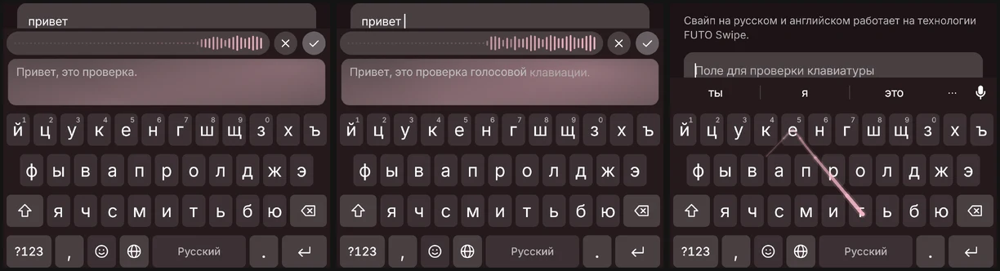

# VoiceKB

**VoiceKB — офлайн-клавиатура для Android с живой диктовкой, свайпом и отдельными настройками для экранов Fold.** Для установки нужен телефон с Android 12 или новее и процессором ARM64. Модели уже в APK. Клавиатура проверена на Samsung Galaxy Z Fold8.

[Скачать APK на GitHub Releases](https://github.com/andreylazeev/voice-kb/releases/latest)



## Возможности

- **Диктовка на русском, английском и украинском.** Нажмите микрофон или удерживайте его во время речи. Режим «Бережная» убирает запинки и повторы уже в черновике, а после записи может дополнительно прогнать текст через выбранную локальную модель. «Дословно» сохраняет текст распознавания.
- **Локальные модели очистки.** В разделе «Диктовка → Локальные модели очистки» можно скачать Qwen3.5 0.8B (0,96 ГБ), Gemma 4 E2B (2,59 ГБ) или Gemma 4 E4B (3,66 ГБ). Карточки показывают размер и относительную нагрузку, а рекомендация учитывает ОЗУ телефона. После загрузки выберите модель. Встроенная очистка доступна сразу.
- **Свайп и подсказки.** Русский и английский свайп работают на технологии **FUTO Swipe**. Для украинского используется словарный декодер. В разделе «Клавиатура → Самообучение» можно управлять подсказками для набора, свайпа и следующего слова, а также сбросить выученные данные.
- **Режимы для Fold.** Обычный, раздельный, плавающий и режимы для одной руки. Выбор режима сохраняется отдельно для внешнего и внутреннего экранов. Плавающую клавиатуру можно передвигать и менять её ширину и высоту. Подведите её к низу, чтобы увидеть контур пристыковки.
- **Темы.** Встроенные палитры, цвета Android и настраиваемый фон с акцентом. В меню клавиатуры темы показаны миниатюрами.

Распознавание, очистка, свайп и самообучение выполняются на устройстве. Интернет используется только для загрузки выбранной модели с Hugging Face. Аудио и текст обрабатываются в оперативной памяти, выученные слова и статистика хранятся в данных приложения. [Политика конфиденциальности](android/app/src/main/assets/privacy-policy-ru.txt)

## Установка

1. Скачайте файл APK со страницы [Releases](https://github.com/andreylazeev/voice-kb/releases/latest).
2. Откройте APK на телефоне и разрешите установку для приложения, из которого открыли файл. Для установки через ADB передайте путь к скачанному APK команде `adb install -r`.
3. Откройте VoiceKB, включите её в списке клавиатур Android и выберите для ввода. Разрешите доступ к микрофону, чтобы диктовать.

## Сборка из исходников

Понадобятся JDK 17 или новее, Android SDK 37, NDK r29 (`29.0.14206865`) и Rust с целью `aarch64-linux-android`. Нативная сборка поддерживает Linux x86‑64 и macOS ARM64. Если NDK установлен вне Android SDK, задайте путь в переменной `VOICE_KB_NDK`.

```sh
rustup target add aarch64-linux-android
./android/gradlew -p android :app:assembleDebug :app:testDebugUnitTest
```

Отладочный APK появится в `android/app/build/outputs/apk/debug/`. Команда `./android/gradlew -p android :app:assembleRelease` собирает неподписанный release APK. Для установки его нужно подписать своим ключом. [Подпись, ADB и проверка на устройстве](android/README.md)

### Проверка свайпа

На 3 000 реальных русских жестах из валидационной выборки Yandex Cup модель FUTO Swipe поставила правильное слово первым в 80,3% случаев, предыдущий декодер VoiceKB — в 58,4%. Обе модели получили одни и те же траектории и словарь. Это результат конкретной выборки. [Данные Yandex Cup](https://disk.yandex.ru/d/IYiSpLob-zAxqg)

## Исходники и лицензии

Код VoiceKB и сборка приложения с tinyasr распространяются по GNU GPL версии 3 или любой более поздней (`GPL-3.0-or-later`). У сторонних компонентов и данных сохраняются их лицензии и уведомления. [LICENSE](LICENSE)

- Android-клавиатура основана на [Hex от Anomaly](https://github.com/anomalyco/hex/tree/9588830c7e01523d56b4e8eeb0a3817f6dc2dd91/android). [MIT](android/LICENSE)
- Локальная диктовка использует [tinyasr](https://github.com/dkaraush/tinyasr) и модель en-ru-uk. Исходники движка и текст GPL‑3.0‑or‑later доступны в [android/vendor/tinyasr](android/vendor/tinyasr).
- Русский и английский свайп используют [FUTO Swipe](https://huggingface.co/futo-org/futo-swipe) и [ExecuTorch](https://github.com/pytorch/executorch). Веса энкодера распространяются на условиях [FUTO Model Weights License 1.0](android/app/src/main/assets/licenses/futo-model-weights.md).
- Словари, статистика и геометрический декодер используют материалы [Dictate Keyboard](https://github.com/DevEmperor/DictateKeyboard) и FlorisBoard. [Атрибуция словарей и остальных компонентов](android/app/src/main/assets/licenses).
- Расширенный русский словарь нецензурной лексики для набора и свайпа основан на BadWords и djantimat. [Источники и лицензии](android/app/src/main/assets/licenses/russian-swear-dictionaries.txt).
- Дополнительные модели очистки загружаются отдельно. LiteRT-LM и предлагаемые веса распространяются по Apache 2.0. [LiteRT-LM](https://github.com/google-ai-edge/LiteRT-LM) · [Qwen3.5 0.8B](https://huggingface.co/litert-community/Qwen3.5-0.8B) · [Gemma 4 E2B](https://huggingface.co/litert-community/gemma-4-E2B-it-litert-lm) · [Gemma 4 E4B](https://huggingface.co/litert-community/gemma-4-E4B-it-litert-lm)
